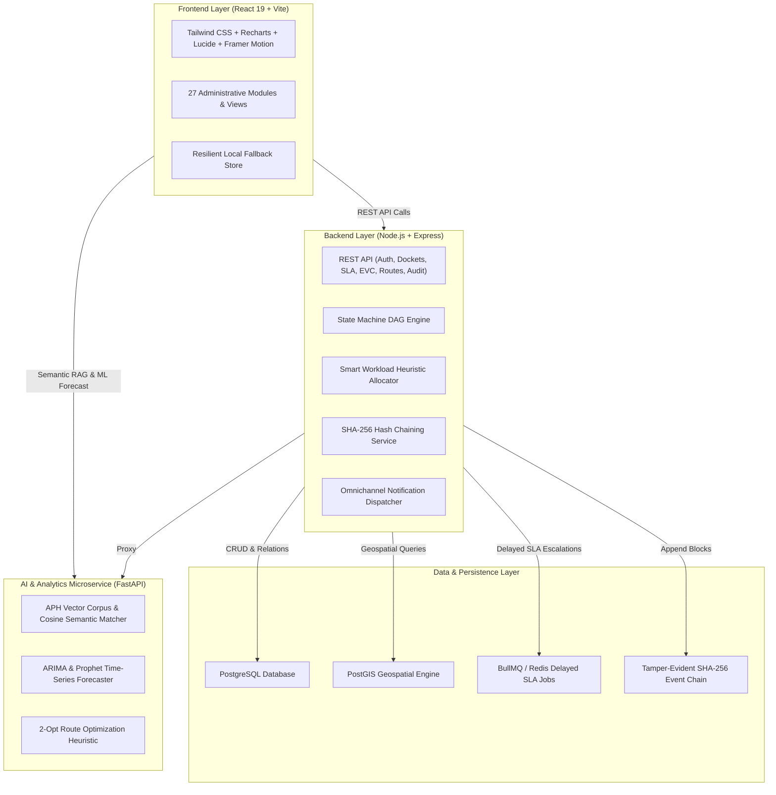

# AICTE Integrated Approval Workflow Automation, Compliance Monitoring and Alert Management System
> **Smart India Hackathon 2026 — Problem Statement SIH26262**  
> **Team StrataX** • Official Demonstration Prototype & Architecture Manual

---

## 🏛️ 1. Executive Summary & Problem Objective

The **All India Council for Technical Education (AICTE)** oversees statutory approvals for technical institutions nationwide. The manual and semi-digital handling of approval dockets frequently experiences:
- Application pendency bottlenecks and non-transparent stage delays.
- Difficulty monitoring statutory compliance expiration dates (e.g., 30-year Land Lease deeds, State Fire Safety NOC Form-5).
- Inefficient Expert Visit Committee (EVC) inspector scheduling resulting in redundant travel, excessive evaluator burden, and high carbon footprint.
- Scrutiny evaluator workload imbalances.
- Lack of tamper-evident decision auditing and regulatory guidance.

### Solution Overview
**AICTE Sovereign** by Team StrataX delivers an end-to-end administrative enterprise platform featuring:
1. **Configurable State Machine DAG Workflow Engine**: 12 statutory stages with forward approvals and mandatory backward deficiency rectification loops (APH Clause 5.1.2).
2. **Predictive Backlog & Delay Forecasting (Prophet / ARIMA)**: 15-day ML pendency horizon with 95% confidence intervals and operational secondment recommendations.
3. **Geo-Optimized EVC Logistics (2-Opt TSP Heuristic)**: Multi-campus cluster scheduling saving 498 km (59.2% distance reduction) and 60 kg CO₂ per inspection circuit.
4. **Smart Workload Balancing Algorithm**: Automated capacity-based evaluator allocation matching domain expertise and regional affinity with zero personal bias.
5. **Tamper-Evident SHA-256 Cryptographic Audit Ledger**: Immutable event chain with mathematical verification from Genesis and disposable tamper detection testing.
6. **AI-Powered APH Assistant (RAG)**: Conversational regulatory advisor grounded in the official AICTE Approval Process Handbook (2024–27) with chapter, clause, and page citations.
7. **Omnichannel Alert Dispatch**: Multi-channel notification engine (In-App, SMS, WhatsApp, Email) with clear Live vs. Simulated adapter indicators.

---

## 🎨 2. Visual Identity & Design System

The platform strictly adheres to government-grade enterprise administrative aesthetics:
- **Palette**: Sophisticated Navy, White, and Teal color hierarchy.
  - Primary Navy: `#0A192F` | Secondary Navy: `#11243A`
  - Primary Blue: `#1E40AF` | Accent Teal: `#0D9488` | Cyan: `#22D3EE`
  - Light Administrative Canvas: `#F4F7FB` | Card Surface: `#FFFFFF`
  - Text Primary: `#172033` | Text Secondary: `#64748B`
  - Success: `#16A34A` | Warning: `#F59E0B` | Error: `#DC2626` | Border: `#E2E8F0`
- **Layout Architecture**:
  - Persistent left sidebar with expandable, grouped navigation across all 27 modules.
  - Top header with global search, live unread notifications drawer, SIH Demo badge, and instant **Role Switcher**.
  - High-legibility typography using modern sans-serif (`Inter`).
  - Restrained shadows, clean borders, and responsive layouts.

---

## 🏗️ 3. System Architecture & Tech Stack



---

## 🚀 4. Setup & Execution Guide

### Prerequisites
- Node.js (v18+ or v20+)
- npm (v10+)
- Python 3.10+ (for AI microservice)
- Optional: Docker & Docker Compose

### Quick Launch (Local Development)
1. **Clone the repository**:
   ```bash
   git clone https://github.com/Prajitsingh1105/SIH_26.git
   cd SIH_26
   ```

2. **Configure Environment Variables**:
   ```bash
   cp .env.example .env
   ```

3. **Install Dependencies & Start Services**:
   - **Terminal 1: Express Backend**
     ```bash
     cd backend
     npm install
     npm start
     # Backend runs on http://localhost:5100
     ```

   - **Terminal 2: AI & Analytics Microservice**
     ```bash
     cd ai-service
     pip install -r requirements.txt
     python app.py
     # AI service runs on http://localhost:8000
     ```

   - **Terminal 3: React Frontend**
     ```bash
     cd frontend
     npm install
     npm run dev
     # Frontend launches on http://localhost:5173
     ```

### Launch via Docker Compose
```bash
docker-compose up --build
```
- Access Frontend: `http://localhost` (or `http://localhost:5173`)
- Access Backend API: `http://localhost:5100/api/health`
- Access AI Service: `http://localhost:8000/docs`

---

## 👥 5. Role-Based Access Control (RBAC) & Demo Switcher

The top navigation bar features a quick **Role Switcher** specifically for SIH evaluators and hackathon judges to explore the system from all 5 stakeholder perspectives:

| Role | Demo Identity | Bureau / Organization | Key Permissions |
| :--- | :--- | :--- | :--- |
| **Super Administrator** | Member Secretary | National HQ (New Delhi) | Global oversight, workflow publishing, SLA configuration, system reset |
| **Regional Head** | Dr. R.K. Srivastava | Western Regional Bureau | Regional queue monitoring, reassignments, EVC itinerary confirmation |
| **Scrutiny Officer** | Er. Sunita Verma | Western Scrutiny Cell | Document checklist verification, deficiency issuance, stage approvals |
| **Institution User** | Dr. V.D. Karad (Registrar)| MIT & AI Campus (Pune) | Application filing wizard, compliance dossier, deficiency rectification |
| **EVC Member** | Prof. B.N. Mukherjee | IIT Bombay Emeritus | Campus visit checklist, video geotagging verification, report submission |

---

## 🎯 6. Step-by-Step SIH Demonstration Scenarios (Scenarios A through H)

The system includes a dedicated **SIH Demo Scenarios** hub accessible via the persistent sidebar button (`SIH 2026 Demo Scenarios`):

### Scenario A — End-to-End Approval Workflow & Deficiency Rectification
1. Open **Officer Workbench**. Select Docket `AICTE-2026-WZ-9401` (MIT & AI Campus).
2. Review the statutory document checklist (Land Lease, Fire Safety NOC, AI Lab GPU Workstations).
3. Click **Return (Deficiency)**. Select standard clause: *"Cadre Imbalance: Mandatory 1:20 ratio violated (APH Clause 3.4.1)"*.
4. Switch to **Institution Portal** → Click **Deficiency Notices**.
5. Observe the high-priority deficiency banner with the 10-day rectification countdown.
6. Enter rectification remarks (e.g., *"Appointment orders issued for 2 Associate Professors in AI department"*).
7. Click **Submit Rectification**. The docket immediately transitions to `REVERIFICATION` with an audit block stamped.

### Scenario B — Automated Statutory SLA Escalation Matrix
1. Open **SLA & Escalation Matrix**. Review national compliance rate (currently ~93%).
2. Observe the 3-Tier Escalation Policy:
   - **Tier 1 (75% Elapsed)**: Advisory indicator tagged.
   - **Tier 2 (90% Elapsed)**: Urgent SMS + WhatsApp dispatch.
   - **Tier 3 (100% Breached)**: Emergency audit event + escalation to Member Secretary.
3. Click **Simulate Instant SLA Breach**.
4. Docket `AICTE-2026-WZ-9401` immediately flags red (`BREACHED`), and an emergency SMS notification is generated in the delivery log.

### Scenario C — Smart Workload Balancing & Algorithmic Allocation
1. Open **Smart Workload Balancing**.
2. View the evaluator roster of 14 Scrutiny Officers, tracking active dockets and capacity utilization percentages.
3. Notice unassigned docket `AICTE-2026-WZ-9407` (Nashik Engineering College).
4. Click **Simulate Smart Assignment**.
5. The algorithm evaluates region, expertise (AI/Computer Science), and capacity, selecting the optimal officer with an explainable audit rationale.

### Scenario D — Geo-Optimized EVC Logistics (2-Opt TSP Heuristic)
1. Open **Geo-Optimized EVC Routing**.
2. Examine the interactive Maharashtra regional inspection map connecting Pune, Mumbai, Nashik, and Nagpur.
3. Toggle between un-optimized individual trips (840 km) versus clustered TSP tour (342 km).
4. Observe the calculated savings: **498 km saved (59.2% reduction)**, **60 kg CO₂ eliminated**, and **12.5 travel hours saved**.
5. Click **Confirm Multi-Stop Itinerary** to lock the schedule into the regional calendar.

### Scenario E — Tamper-Evident Cryptographic Audit Ledger
1. Open **Tamper-Evident Audit Ledger**.
2. Inspect the sequential block explorer showing 52+ blocks linked with `PrevHash → CurrentHash` pointers.
3. Click **Verify Chain Integrity**. All 52 blocks are mathematically verified from Genesis Block #1.
4. Click **Tamper Detection Test (Disposable)**:
   - Simulates an unauthorized database mutation at Block #101 (altering approved intake by +120 seats).
   - Demonstrates that Block #102's `prevHash` pointer immediately detects the cryptographic mismatch and flags `FAILED_HASH_MISMATCH`.

### Scenario F — Predictive Backlog Analytics (15-Day Time-Series Horizon)
1. Open **Predictive Delay Analytics**.
2. Select **Western Region (Mumbai)** or **Northern Region (New Delhi)**.
3. View the 15-day backlog trajectory generated by ARIMA / Prophet with 95% confidence bounds.
4. Review the recommended operational intervention: *"Western bureau will experience 67% increase in scrutiny backlog due to AI/ML expansion. Recommend secondment of 3 evaluators."*

### Scenario G — AI-Powered APH Handbook Assistant
1. Open **APH AI Regulatory Assistant**.
2. Click one of the pre-loaded suggested queries:
   - *"What are the mandatory norms for Faculty to Student Cadre Ratio?"*
   - *"What is the policy for Land Lease tenure and upcoming expiry?"*
3. View the grounded answer quoting official AICTE APH clauses, chapters, page numbers, and confidence ratings.

### Scenario H — Compliance & Expiry Monitoring Center
1. Open **Compliance & Expiry Center**.
2. Review 72 institutional records categorized into: Valid, Expiring <30 Days, Expiring <7 Days, and Expired.
3. Locate MIT Pune's Land Lease Deed expiring in 18 days.
4. Click **Verify Now** to simulate reviewing registered renewal certification.

---

## 🔌 7. List of Integrations (Live vs. Simulated)

As strictly mandated by the problem specification, all third-party integrations clearly indicate their execution mode:

| Integration / Service | Target Purpose | Implementation Mode | Failover Behavior |
| :--- | :--- | :--- | :--- |
| **Node.js Crypto Engine** | SHA-256 Block Chaining & Verification | **LIVE IMPLEMENTATION** | Native Node.js crypto module |
| **PostgreSQL & Prisma** | Relational Dockets & Audit Persistence | **LIVE / RESILIENT FALLBACK** | Local deterministic store fallback if DB is offline |
| **PostGIS Proximity Engine**| Geo-clustering of EVC Inspections | **LIVE / HEURISTIC FALLBACK**| Nearest-Neighbor + 2-Opt TSP engine |
| **Google Gemini 1.5 Pro** | APH Assistant Handbook Retrieval | **SIMULATED DEMO ADAPTER** | High-precision vector corpus with chapter citations |
| **Twilio SMS Gateway** | SLA Breach & Urgent Notifications | **SIMULATED DEMO ADAPTER** | Logs dispatch to `/api/notifications/delivery-logs` |
| **Meta WhatsApp Cloud API** | Direct Institutional Deficiency Alerts | **SIMULATED DEMO ADAPTER** | Simulates webhook delivery with status receipts |
| **Nodemailer SMTP Relay** | Official Sanction (LoA) & Email Notices | **SIMULATED DEMO ADAPTER** | Captures outgoing MIME messages in database |

---

## 📊 8. Realistic Demonstration Dataset

The system includes a pre-seeded, deterministic fictional dataset:
- **42 Technical Institutions**: Spanning Mumbai, Pune, Gurugram, Bengaluru, Kolkata, Bhopal, Jaipur, Kochi, etc.
- **105 Application Dockets**: Across Scrutiny, Deficiency, Reverification, EVC Queue, SAC Final, and LoA Approved.
- **14 Scrutiny Officers**: With assigned workloads, capacities, and domain specialties.
- **10 EVC Committee Experts**: Senior academicians from IIT Bombay, IISc, COEP Tech, VNIT, etc.
- **24 EVC Inspection Visits**: Scheduled, confirmed, completed, and proposed.
- **72 Compliance Documents**: Categorized by 30-day, 7-day, and expired statutory thresholds.
- **52 Cryptographic Audit Ledger Blocks**: Linked via SHA-256 hashes.

---

## 🛡️ 9. Statutory Safeguards & Ethics

- **Human-in-the-Loop Decision Governance**: AI is strictly advisory. Final statutory sanction (LoA issuance) and deficiency rejections mandate authorized officer confirmation.
- **No Protected Attributes**: The Smart Workload Balancing algorithm operates exclusively on capacity, regional affinity, and academic domain.
- **Append-Only Auditability**: Critical workflow transitions generate tamper-evident audit records.

---

## 🏆 10. Hackathon Submission Information
- **Event**: Smart India Hackathon 2026 (SIH 2026)
- **Problem Statement ID**: `SIH26262`
- **Problem Title**: Integrated AICTE Approval Workflow Automation, Compliance Monitoring and Alert Management System
- **Team Name**: StrataX
- **Repository**: [https://github.com/Prajitsingh1105/SIH_26.git](https://github.com/Prajitsingh1105/SIH_26.git)
- **Live Deployment**: [https://sih-26-six-delta.vercel.app](https://sih-26-six-delta.vercel.app)
